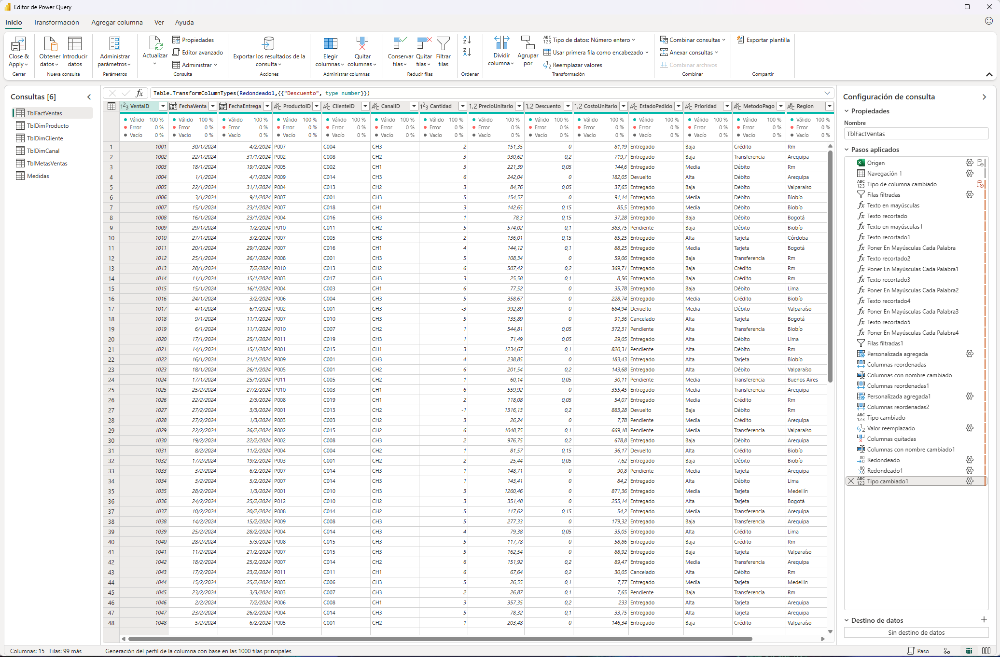
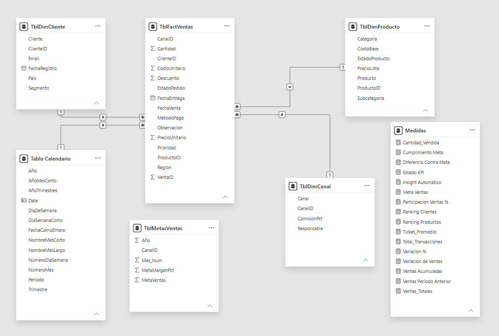
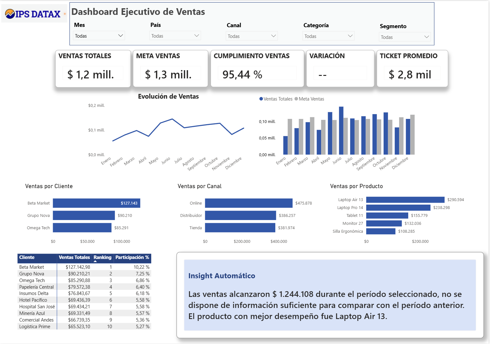
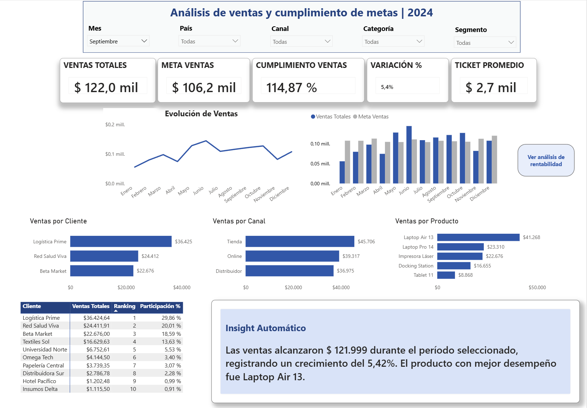
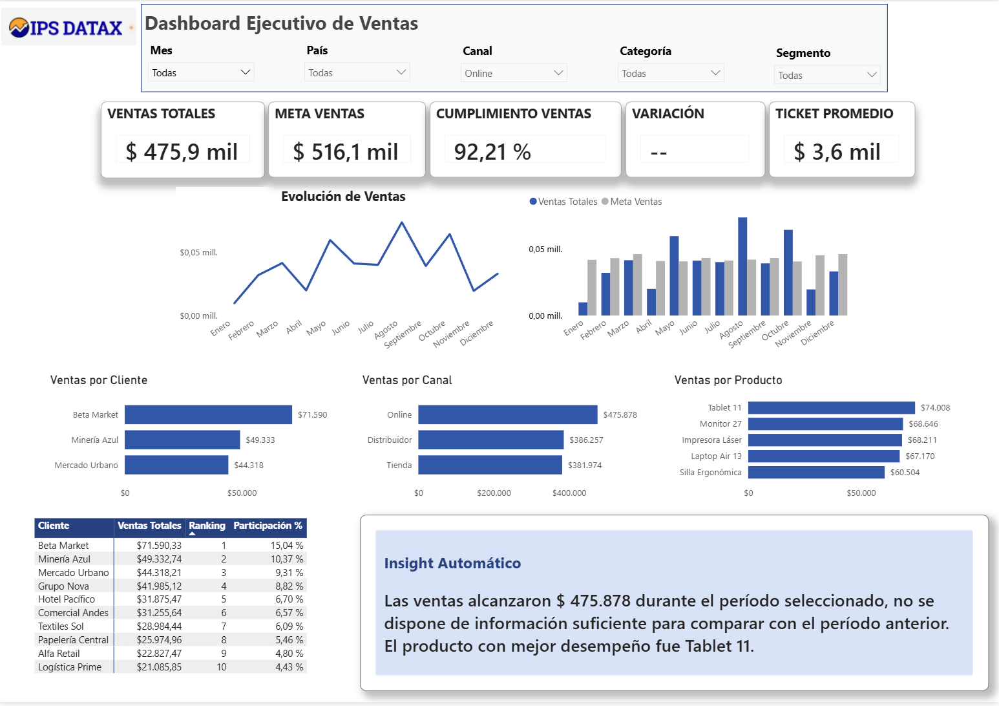

# 📈 Análisis de ventas y cumplimiento de metas | Power BI — 2024

Proyecto de análisis comercial desarrollado en **Power BI** a partir de datos simulados de una empresa ficticia del sector tecnológico. El objetivo es evaluar el desempeño de ventas de 2024, analizar el cumplimiento de metas e identificar oportunidades de mejora mediante indicadores y visualizaciones interactivas.

## ⚙️ Herramientas utilizadas

- **Excel:** fuente de datos del proyecto.
- **Power Query:** limpieza, transformación y validación.
- **Power BI:** modelo de datos, visualizaciones e interactividad.
- **DAX:** indicadores de ventas, inteligencia temporal, rankings y cumplimiento de metas.

## ❔ Objetivo y preguntas de negocio

El objetivo fue convertir los datos de ventas en información útil para el seguimiento comercial y responder:

1. ¿Se alcanzaron las metas de ventas?
2. ¿Cómo evolucionaron las ventas durante 2024?
3. ¿Qué productos generaron mayor facturación?
4. ¿Qué clientes tuvieron mayor participación?
5. ¿Qué canal aportó más ventas?

## 🗂️ Estructura del repositorio

```text
dashboard-ejecutivo-ventas-power-bi/
├── dataset/
│   └── datos_ventas_tecnologia_2024.xlsx
├── screenshots/
│   ├── dashboard-general.png
│   ├── dashboard-filtro-mes.png
│   ├── dashboard-filtro-canal.png
│   ├── modelo-datos.png
│   └── power-query-limpieza.png
├── Dashboard-Ejecutivo-Ventas.pbix
├── medidas_dax_documentacion.md
└── README.md
```

La carpeta `dataset` contiene el Excel original y el archivo `.pbix` incluye el modelo de datos y el dashboard interactivo. Las capturas muestran el dashboard general, dos ejemplos de filtrado, el modelo de datos y el proceso de limpieza en Power Query.

## ⏳ Exploración y preparación de los datos (EDA y ETL)

Se partió de cinco tablas: **ventas, productos, clientes, canales y metas comerciales**.

En **Power Query** se realizaron las principales transformaciones:

- **Ventas:** exclusión de dos registros sin fecha de venta; normalización de identificadores, textos, precios y costos; reemplazo de descuentos nulos por cero. Se conservaron las cantidades negativas asociadas a devoluciones. La tabla final contiene **578 registros**.
- **Productos:** estandarización de nombres y categorías, corrección de tipos numéricos y eliminación de un identificador duplicado. La dimensión quedó con **12 productos únicos**.
- **Clientes:** normalización de países, segmentos y correos electrónicos. Se conservaron los **20 clientes**, incluido un correo faltante que no afectaba el análisis.
- **Canales:** limpieza de textos y corrección de comisiones para **Online, Tienda y Distribuidor**.
- **Metas:** verificación de **36 registros**, correspondientes a los 12 meses de 2024 para los tres canales.

Se revisó la calidad de las columnas relevantes y los campos necesarios para las relaciones y los indicadores.
### Limpieza y transformación en Power Query



### Criterio comercial utilizado

Las medidas principales de facturación, unidades vendidas y transacciones contabilizan **únicamente los pedidos con estado `Entregado`**. Los registros pendientes, cancelados y devueltos permanecen en el dataset, pero no se incluyen en estos KPI.

Esta definición resultó fundamental: al corregir el indicador, el cumplimiento anual de metas pasó del **117,77 %** al **95,44 %**. El cambio muestra por qué es necesario validar el significado de cada métrica, además de comprobar que su fórmula funcione.

## ⭐ Modelo de datos

Se construyó un **modelo en estrella** con `TblFactVentas` como tabla central, relacionada mediante vínculos activos de uno a muchos y filtrado unidireccional con las dimensiones:

- `TblDimCliente`
- `TblDimProducto`
- `TblDimCanal`
- `Tabla Calendario`

La tabla calendario se creó con DAX, contiene las **366 fechas de 2024** y fue configurada como tabla de fechas.

`TblMetasVentas` se mantuvo sin relaciones físicas: la medida de metas utiliza **`TREATAS`** para aplicar los filtros de año, mes y canal. Las métricas se organizaron en una tabla independiente denominada `Medidas`.



## 📐 Medidas DAX

Se documentaron **22 medidas DAX**: las 17 del análisis original y cinco medidas nuevas de rentabilidad, comprobadas en la versión local de Power BI. Estas últimas se incorporarán al archivo `.pbix` publicado al finalizar la revisión del dashboard.

Entre las funciones utilizadas se encuentran `CALCULATE`, `SUMX`, `DIVIDE`, `DISTINCTCOUNT`, `DATEADD`, `TOTALYTD`, `RANKX`, `REMOVEFILTERS`, `TREATAS`, `TOPN` y `SWITCH`.

Las fórmulas finales y sus explicaciones están en **[Documentación de medidas DAX](medidas_dax_documentacion.md)**.

## 🖥️ Dashboard e interactividad

El informe permite explorar los resultados mediante cinco segmentadores: **Mes, País, Canal, Categoría y Segmento**. Incluye tarjetas de ventas, meta, cumplimiento, variación y ticket promedio; gráficos de evolución mensual, ventas frente a metas y desempeño por cliente, producto y canal; un ranking de clientes y un texto de insight generado con DAX.

La tarjeta **VARIACIÓN %** utiliza una medida de presentación adicional (`Variacion % Tarjeta`): en la vista general indica **«Seleccioná un mes»**, muestra el porcentaje cuando existe una comparación mensual válida y señala **«Sin período anterior»** cuando no hay base de comparación. La medida numérica original se conserva para los cálculos.

Se personalizaron las interacciones para preservar el contexto de comparación:

- Al seleccionar un **mes**, los indicadores y rankings se actualizan, mientras que los dos gráficos temporales mantienen la vista de todo 2024.
- Al seleccionar un **canal**, los indicadores y el resto del informe se actualizan, pero el gráfico de ventas por canal conserva la comparación entre los tres canales.


### Dashboard general



### Filtro por mes: septiembre de 2024



### Filtro por canal: Online


  

## 💰 Rentabilidad por canal (mejora en desarrollo)

Se incorporaron y validaron en la versión local de Power BI medidas de **costo de productos vendidos, margen bruto, comisiones, margen después de comisiones y margen porcentual**. Bajo el criterio de pedidos entregados, el margen después de costos de productos y comisiones fue de **$341.220,28 (27,43 % de las ventas)**.

En la comparación por canal, **Online** presentó el mayor margen monetario (**$133.828,71**) y porcentual (**28,12 %**), seguido de Distribuidor (**27,41 %**) y Tienda (**26,58 %**). El cálculo descuenta costos de productos y comisiones, pero **no representa utilidad neta**. Los cálculos y resultados están documentados en [medidas DAX](medidas_dax_documentacion.md).

> **Estado de publicación:** estas medidas se validaron en el archivo local y están documentadas aquí; el `.pbix` y las capturas de GitHub se actualizarán al finalizar las correcciones.

## 💎 Hallazgos comerciales de 2024

### 1. La meta anual no se alcanzó, aunque hubo seis meses consecutivos de cumplimiento

| Indicador | Resultado |
|---|---:|
| Ventas de pedidos entregados | $1.244.108,50 |
| Meta anual | $1.303.553 |
| Cumplimiento | **95,44 %** |
| Diferencia frente a la meta | **-$59.444,50** |

El análisis mensual permitió identificar **tres períodos**:

- **Enero–abril:** ningún mes alcanzó la meta.
- **Mayo–octubre:** seis meses consecutivos con ventas superiores a las metas mensuales. **Junio** registró el mayor importe de ventas (**$144.524,31**) y el mayor cumplimiento (**130,31 %**).
- **Noviembre–diciembre:** los resultados volvieron a quedar por debajo de sus objetivos.

El buen desempeño de mayo a octubre no fue suficiente para compensar los desvíos negativos del resto del año. Este patrón no se observa al mirar únicamente el KPI anual.

**Recomendación:** comparar productos, clientes y canales de los meses de mayor cumplimiento con los períodos que quedaron por debajo de las metas, para identificar oportunidades de mejora. Los datos permiten detectar el patrón, pero no establecer sus causas sin un análisis adicional.

### 2. Dos laptops concentraron una parte importante de la facturación

**Laptop Air 13** fue el producto líder, con **$290.593,58**, seguido de **Laptop Pro 14**, con **$238.298,18**. Juntas representaron aproximadamente **42,5 %** de las ventas anuales.

**Recomendación:** analizar su desempeño por período y canal y complementar la facturación con información de márgenes antes de definir acciones comerciales.

### 3. Beta Market fue el cliente principal

**Beta Market** generó **$127.142,98**, equivalentes al **10,22 %** de las ventas anuales. Le siguieron **Grupo Nova** y **Omega Tech**.

**Recomendación:** hacer seguimiento de los principales clientes y explorar oportunidades en el resto de la cartera, sin interpretar la concentración de ventas como un riesgo demostrado por sí solo.

### 4. Online fue el canal con mayor facturación

El canal **Online** aportó aproximadamente **$475.878** (**38,3 %** del total), por delante de Distribuidor y Tienda.

**Recomendación:** estudiar el potencial de crecimiento del canal junto con sus costos y comisiones. Mayor facturación no implica necesariamente mayor rentabilidad.

## ✅ Conclusión

El proyecto permitió recorrer un proceso de análisis de punta a punta: preparar datos con inconsistencias, construir un modelo de datos, definir indicadores de negocio, desarrollar un dashboard interactivo y convertir los resultados en hallazgos y recomendaciones.

El aprendizaje más importante fue la necesidad de **validar los criterios comerciales detrás de las medidas**: una fórmula puede funcionar correctamente y, aun así, conducir a conclusiones equivocadas si incluye operaciones que no corresponden al indicador analizado.
